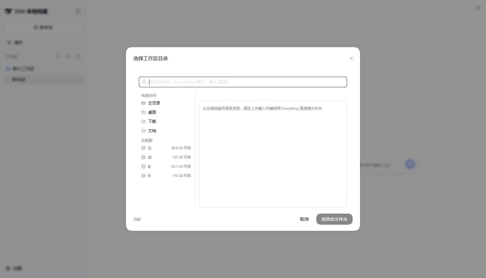
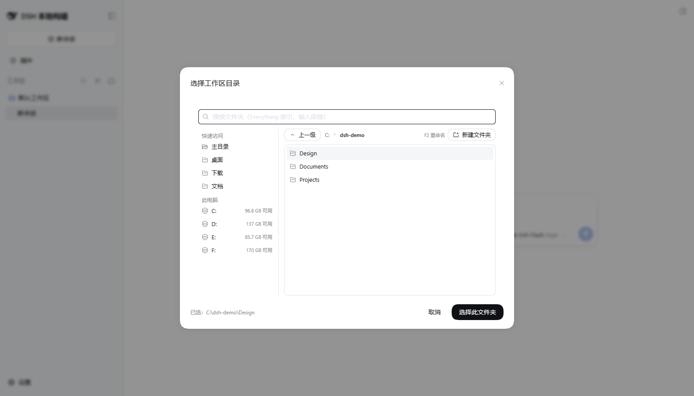
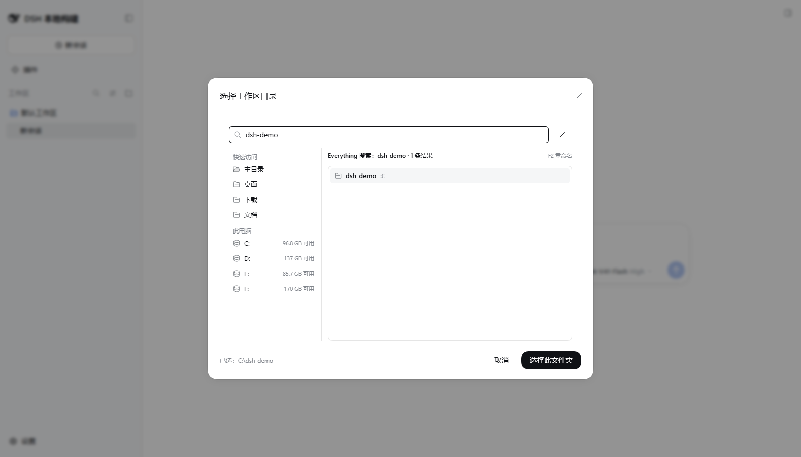

# dsh-everything-search

把 DSH 的「新建工作区」从 **Windows 原生文件夹对话框**换成 **DSH 风格的应用内对话框**：

- **盘符逐级浏览**：左栏「最近使用 / 快速访问 / 此电脑（盘符 + 可用空间）」，右栏面包屑 + 双击进入 + 上一级 + 新建文件夹。
- **Everything 全盘搜索**：顶部输入即搜，用 voidtools 官方 `es.exe` 走 Everything 的 MFT 索引，只返回文件夹（实测单次查询约 45 ms），命中片段高亮，方向键选择、回车确认。
- **完全跟随 DSH 主题**：控件外观由本插件自带样式 + `--dsw-alias-*` 主题 token 保证，浅色/深色自动一致。
- 两者可随时混用：搜到目标直接选，搜不到就手动点下去；Everything 不可用时**只有搜索受影响**，手动浏览照常。



| 逐级浏览 + 单击选中（右下角选中的就是这一行） | Everything 搜索 |
|---|---|
|  |  |

> 截图里的 `C:\dsh-demo` 是演示目录，不代表你的机器。

## 功能一览

| 能力 | 说明 |
|---|---|
| 接管「新建工作区」 | 侧栏 `+` 与对话空态 hero 两个入口都换成应用内对话框 |
| 盘符逐级浏览 | 快速访问（主目录/桌面/下载/文档…）+ 此电脑（盘符 + 可用空间），双击进入、面包屑跳转、上一级 |
| Everything 搜索 | 输入即搜（默认 80 条），只返回文件夹，命中高亮，回车/双击进入，方向键选择 |
| 选中即目标 | 单击选中某项后，右下角「选择此文件夹」选中的就是它；点空白处取消选中则回到当前目录 |
| 最近使用 | 可折叠/展开，最多 5 条，记忆在 localStorage |
| 新建 / 重命名 | 新建文件夹；`F2` 重命名（Windows 资源管理器语义，回车提交、Esc 取消） |
| 噪声屏蔽 | 其它 AI 工具/DSH 自己的会话目录按规则默认隐藏，标题栏「已屏蔽 N 项」可临时显示 |
| 可回滚 | 卸载插件即恢复官方原生选择器 |

## 它接管了什么

DSH 的「选目录」是一个 single 槽位（`sidebar.workspaces.directoryFlow` 与
`conversation.hero.workspace.directoryFlow`），官方 `directory-picker-auto` 在
Windows + 127.0.0.1 下解析到系统对话框并占用该槽位。本插件的 `cordis.patch.yml`
在 profile 组合里：

```yaml
- id: directory-picker
  disabled: true          # 让出 single 槽位
- insert:
    - id: dsh-everything-search
      name: dsh-everything-search
```

所以卸载/禁用本插件即自动回到官方原生选择器，无需其它清理。

## 依赖准备：获取 `es.exe`（必需）

搜索这一半要用 voidtools 官方的命令行 `es.exe`。它属于 Everything 本体之外的**单独下载**，
且是第三方免费软件，**本仓库不内置**（请自行下载，遵守 voidtools 的许可）：

1. 打开 <https://www.voidtools.com/downloads/>，下载 **Everything Command-line Interface**（`ES-1.1.0.38.x64.zip` 或更新版本）。
2. 解压出 `es.exe`，放到本插件的 `bin/es.exe`（`bin/` 目录已在 `.gitignore` 里）。
3. 确保 Everything 本体在运行（服务 + 用户实例）。

查找顺序（`src/index.js` 里实现，任一可用即可）：

```
环境变量 DSH_EVERYTHING_ES → <插件目录>\bin\es.exe → %ProgramFiles%\Everything\es.exe → PATH 里的 es.exe
```

所以如果你机器上装了 Everything，也可以直接把 `es.exe` 放进它的安装目录。

## 安装（desktop profile）

App 内「插件」页从路径安装，或手工三步：

1. `~/.dsh/profiles/desktop/package.json`
   - `dependencies` 增加 `"dsh-everything-search": "link:<本仓库在本机的绝对路径>"`
   - `dsh.profile.bundles` 末尾追加 `"dsh-everything-search"`
2. `~/.dsh/profiles/desktop/node_modules/dsh-everything-search` → 指向本仓库目录的符号链接。
3. 重启 DSH 桌面版（profile 只在启动时组合）。

> CLI 无法安装 desktop profile（`dsh plugin --profile desktop` 会被明确拒绝：
> "profile desktop is managed exclusively by the Electron application"）。
>
> 客户端改动（`src/client.js`）会被 `@deepseek-ai/dsh-client-hmr` 自动热重载；
> 宿主端改动（`src/index.js`、`cordis.patch.yml`、profile 组合）需要重启 DSH。

## 回滚

```powershell
$p = "$env:USERPROFILE\.dsh\profiles\desktop"
Copy-Item "$p\package.json.bak-dsh-everything-search" "$p\package.json" -Force
Copy-Item "$p\cordis.patch.yml.bak-dsh-everything-search" "$p\cordis.patch.yml" -Force
Remove-Item "$p\node_modules\dsh-everything-search" -Force
# 重启 DSH
```

## 配置

| 项 | 说明 |
|---|---|
| `bin/es.exe` | Everything 命令行（自己放，本仓库不内置；见上节）。也可用环境变量 `DSH_EVERYTHING_ES` 指向别处，或放进 `%ProgramFiles%\Everything\es.exe` |
| Everything 本体 | 需在运行（服务 + 用户实例）。未运行时搜索报 `everything-not-running`，界面提示但浏览照常 |
| 索引范围 | Everything 只索引 NTFS 固定卷；网络盘/U 盘请手动浏览或粘贴路径 |

## 宿主端 RPC

`POST /api/dsh-everything-search.<endpoint>`（信封协议与 DSH 客户端 RPC 一致，
也接受裸 JSON）：

| 端点 | 入参 | 返回 |
|---|---|---|
| `status` | — | `es.exe` / Everything 版本与可用性 |
| `hello` | 浏览器半自报 | 加载自证（写 `events.jsonl`） |
| `noise` | — | 噪声规则（客户端据此保持与宿主一致） |
| `places` | — | 主目录 + 桌面/下载/文档/图片/音乐/视频（存在才返回） |
| `drives` | — | 盘符列表（含 total/free） |
| `list` | `{ path }` | 子文件夹（隐藏/屏蔽标记、父目录、是否盘符根） |
| `mkdir` | `{ parent, name }` | 新建文件夹并返回路径 |
| `rename` | `{ path, name }` | 同目录改名并返回新路径 |
| `search` | `{ query, limit }` | `[{ name, path, full, blocked? }]`，`/ad` 只要文件夹 |

## 自检

```powershell
node --check src/index.js; node --check src/client.js
node --test test/plugin.test.mjs test/render.test.mjs   # 24 项：宿主纯函数 + es.exe 链路 + bundle 注册协议 + 真实 React 渲染
node tools/probe.mjs 项目                                # 真机链路：status/places/drives/list/search
node tools/verify-composition.mjs                        # 用 DSH 自己的 patch 引擎验证组合语义
```

## 端到端验证（真实 DSH 运行时 + 真实浏览器）

用**隔离 DSH_HOME + 隔离 profile** 起一份 DSH 实例，完全不碰用户正在用的 App 与 `~/.dsh` 状态：

```powershell
$edsHome = Join-Path $env:TEMP 'eds-verify-home'      # 独立 home：workspace.json / sessions 全隔离
# 建 profile：$edsHome\profiles\eds-verify\{package.json,cordis.yml} + node_modules 软链到本插件
# bundle 列表：@deepseek-ai/dsh-base, @deepseek-ai/dsh-web-app, dsh-everything-search

$env:DSH_HOME = $edsHome
node --import tsx/esm apps/cli/src/bin.ts --profile eds-verify --port 3100 --no-open
```

然后：

```powershell
# A. 组合与接口：引导图含本插件、原生选择器已消失、bundle 可服务、RPC 全通（12 项）
node tools/verify-instance.mjs --url "http://127.0.0.1:3100/?token=<token>"

# B. 真浏览器点击（Chrome CDP），场景可任选：
#    1 侧栏 + → 本插件对话框 → 盘符逐级浏览 → Everything 搜索
#    2 对话空态 hero 槽位（conversation.hero.workspace.directoryFlow）→ 同一对话框
#    3 确认建工作区 → 侧栏出现新工作区
#    4 噪声过滤 / 搜索双击进入 / 最近使用折叠 / 最多 5 条
#    5 噪声屏蔽计数 + 「已屏蔽 N 项」开关
#    6 F2 重命名（行内编辑、Esc 取消不关窗、回车提交并落到改名后的项）
#    7 选中优先：单击选中 → 右下角按钮选中的就是它；点空白处回到当前目录
node tools/ui-check.mjs --url "http://127.0.0.1:3100/?token=<token>" --scenarios 1,3,4,5,6,7 --create-target "E:\tmp"
```

最近一次结果：`verify-instance` **12/12**、`ui-check` 全场景 **37/37**、单测 **24/24**。

README 顶部那三张演示图由下面的脚本在**干净实例 + 演示目录**上生成（不含个人路径）：

```powershell
node tools/make-screenshots.mjs --url "http://127.0.0.1:3100/?token=<token>"
```

清理：停掉实例进程、删掉 `$env:TEMP\eds-verify-home` 即可（与 `~/.dsh` 无关）。

## 加载自证（不依赖 token 的验收钩子）

宿主半与浏览器半加载时各写一条 JSONL 到插件数据目录：

```
<dsh home>/plugins/dsh-everything-search/events.jsonl
{"time":"…","event":"host-loaded","pid":…,"version":"0.1.0","platform":"win32","home":"…"}
{"time":"…","event":"client-loaded","pid":…,"version":"0.1.0","userAgent":"…","href":"http://127.0.0.1:19387/","slots":"sidebar.workspaces.directoryFlow,conversation.hero.workspace.directoryFlow"}
```

所以「某个 DSH 实例有没有真正加载本插件」可以直接看文件确认，不必拿它的访问 token：

```powershell
Get-Content "$env:USERPROFILE\.dsh\plugins\dsh-everything-search\events.jsonl"
# 桌面版重启后应看到一条 host-loaded（App 宿主进程 pid）+ 一条 client-loaded（href 指向 19387）
```

`hello` 端点就是这个自报通道（`POST /api/dsh-everything-search.hello`），也可用于排障。

## 回滚验证（也实测过）

回滚 = 把插件从 profile 的 `dsh.profile.bundles` 里去掉（或整段还原 `package.json`/`cordis.patch.yml` 备份）+ 重启。在隔离实例上实测：

```powershell
node tools/verify-instance.mjs --url "http://127.0.0.1:3100/?token=<token>" --expect rollback
# PASS 回滚后：引导图不再包含本插件
# PASS 回滚后：官方原生选择器回来了   ← directory-picker-native 重新出现在客户端条目图里
# PASS 回滚后：本插件 RPC 路由已消失   ← /api/dsh-everything-search.* → 404
# 7/7 通过
```

即：卸载后 Windows 原生「选择文件夹」自动恢复，无需其它清理。

## 桌面版实测（2026-10-05）

桌面版重启后已确认接管，证据链：

- `~/.dsh/plugins/dsh-everything-search/events.jsonl`：`host-loaded`（App 宿主 pid，home 为真实 `~/.dsh`）+ `client-loaded`（`@deepseek-ai/dsh-desktop/0.2.0-rc.2 … Electron/44.0.0`，`href: dsh-app://app/`，两个槽位名）。
- 用户实际点击「+」弹出的即本插件对话框。

### 热重载行为（改代码时有用）

- **客户端半**（`src/client.js`）：桌面版挂了 `@deepseek-ai/dsh-client-hmr`，它每 500 ms stat-poll 已服务的 bundle，文件一改就自动重载——实测改完 client.js 后 App 在同一秒写出新的 `client-loaded`，**不需要重启**。
- **宿主半**（`src/index.js` / `cordis.patch.yml` / profile 组合）：**需要重启 DSH** 才会重新组合。

### 修过的一个视觉瑕疵

症状：输入字符的瞬间，对话框右上出现一条竖直长条。

原因：搜索中的 12px 转圈 `<span class="edsSpin">` 是 `.edsSearchRow` 的直接子元素，被一条过宽的 `.edsSearchRow > span { flex: 1 }` 横向拉成整行宽的椭圆；`border-radius: 50%` + 旋转动画到竖直那一帧就成了一条长条。

修法：删掉该转圈（搜索状态由列表里的「正在搜索…」表达），并把撑满整行的规则收窄到专用类 `.edsSearchField` / `.edsCreateField`。回归检查已进自动化：

```powershell
node tools/ui-check.mjs --url "…" --scenarios 1
# PASS 场景1：输入瞬间没有被拉伸的元素（长条特效回归）
```

### 修过的第二个视觉瑕疵：footer 贴住卡片边缘

症状：底部「取消 / 选择此文件夹」下方没有留白，卡片那条底线与按钮相切。

原因：我在 `.edsDialog` 里写了 `padding: 0`，把 Modal 卡片默认的 `padding: 0 0 24px`（底部 24px 留白）清零了。

修法：改回 `padding: 0 0 20px`，并给 `.edsFooter` 加 `padding-top: 12px` 理开列表与按钮的间距。回归检查同样进了自动化：

```powershell
# PASS 场景1：footer 与卡片边缘留有白边且不越出视口
#   — {"cardW":760,"cardH":596,"minBottomGap":20,"minRightGap":24,"fitsViewport":true}
```

> 教训（两次都踩同一类坑）：`.edsDialog` 里的 CSS 是写在 JS 模板字符串中的，
> 注释里**不能出现反引号**，否则会提前截断模板字符串导致整个 bundle 抛错；
> 另外不要用「父容器 > 标签」这种宽选择器做布局，它会把行内其它同类元素一起拉变形。

## 交互约定（v0.1.0 起）

- **进入下一级**：双击行，或在选中行上按回车（搜索态与浏览态一致）。
- **选定工作区（选中优先）**：单击某行选中它 → 右下角「选择此文件夹」选中的**就是这一行**；
  底部会显示「已选：<完整路径>」。
  - 没有选中项时（刚打开、或点列表空白处取消选中），按钮选中的是**当前目录**，底部显示「当前：<路径>」。
  - 搜索态与浏览态行为一致；单击选中 + 点按钮，不必先双击进目录。
  - 每次打开对话框都从「快速访问 / 此电脑」开始（不会残留上次浏览的目录）。
- **最近使用**：可折叠/展开（状态记忆在 localStorage），**最多 5 条**。
- **重命名（F2，Windows 资源管理器语义）**：选中一行 → 按 `F2` → 行内变输入框且**全选原名**
  → 回车提交 / `Esc` 取消 / 失焦提交；选中时会显示「F2 重命名」提示。
  - 改名走宿主端 `rename` 端点（同一父目录内改名，不做移动）；重名、非法字符、
    不存在、无权限都会在对话框内提示原因。
  - 浏览态改名后刷新当前目录并**选中改名后的那一项**；搜索态改名后跳到它所在目录并选中它
    （旧关键词已搜不到新名字，直接留在原地会变成空列表）。
  - `Esc` 取消时**不会**关闭对话框（在卡片作用域拦住事件，不让 Modal 的 Esc 生效）。
  - ⚠️ **`rename` 是宿主端能力，需要重启一次 DSH 才可用**；在此之前按 F2 会给出
    「需要重启」的提示（客户端用 `noise` 端点探测宿主版本，不会抛 HTTP 404）。
- **噪声目录默认不显示，且随时可显示**：默认隐藏，标题栏出现「已屏蔽 N 项」按钮，
  点一下即可把被屏蔽的条目显示出来（置灰 + `已屏蔽` 标记），再点收起。

### 噪声规则（按「名字形状」判定，不逐个工具写死）

AI 工具普遍把工作目录编码进文件夹名（`D:\Projects\foo` → `D--Projects-foo`、
`-d-Projects-foo-…`，非 ASCII 走 `~XXXX~` 十六进制转义），所以按形状判定比逐个工具
写路径更耐用：

| 类型 | 规则 |
|---|---|
| 名字 | `^--`、`^-{1,2}[A-Za-z]-`、`^[A-Za-z]-{2}`、`~[0-9A-Fa-f]{4}~`、`-{5,}` |
| 路径 | `\.dsh\sessions\`、`\.trae-cn\memory\projects\`、`\.qoder-cn\(logs\|projects\|tmp\|sessions)\`、`\.codex\sessions\`、`\.claude\projects\` |

**可扩展**：在 `<dsh home>/plugins/dsh-everything-search/config.json` 里追加（宿主重启后生效）：

```json
{
  "noiseNames": ["^tmp-", "~[0-9A-Fa-f]{4}~"],
  "noisePaths": ["\\\\AppData\\\\Local\\\\Temp\\\\"],
  "noiseDisableDefaults": false
}
```

`noiseDisableDefaults: true` 会丢掉内置规则、只用你给的；坏正则会被跳过并告警，不影响其它规则。
宿主经 `noise` 端点把编译后的规则下发给客户端（客户端拿不到时用同一份内置规则），
所以界面行为与宿主始终一致。

对应自动化（场景 4 / 5 / 6）：

```powershell
node tools/ui-check.mjs --url "…" --scenarios 4,5,6
# 场景4：搜索结果已剔除会话目录（-- / .dsh\sessions） — {"total":27,"dash":0,"sessions":0}
# 场景4：搜索里双击进入下一级（对话框未关闭、查询清空、面包屑跟着走）
# 场景4：双击不会直接建工作区 / 单击选中后点右下角按钮才建工作区
# 场景4：最近使用可折叠展开 / 最近使用最多 5 条
# 场景5：默认视图里没有噪声目录，且给出屏蔽计数 — {"total":27,"junk":0,"toggleText":"已屏蔽 35"}
# 场景5：点「已屏蔽 N 项」可把它们显示出来（带标记、置灰） — {"blocked":35,"total":62}
# 场景5：可以再次隐藏
# 场景6：选中后出现 F2 提示 / F2 进入行内改名（输入框出现）
# 场景6：Esc 取消改名且不关闭对话框 — {"dialogOpen":true,"editing":false}
# 场景6：回车提交改名，并落到改名后的项上 — selected=…\eds-ui-rename-dst
#        （磁盘上同步核对：eds-ui-rename-src 消失、eds-ui-rename-dst 生成）
```

## 已知限制

- 单选：现有 flow 只接收一个路径，一次只能建一个工作区。
- 搜索不做结果分页（客户端默认要 80 条，宿主上限 200）。
- 隐藏项用「点开头 + 系统目录名」判定，未读 Windows 隐藏属性。
- 噪声规则命中「名字形状」，极端情况下可能误伤同名目录；用「已屏蔽 N 项」开关即可核对/显示。
- 未做「文件」展示（对话框只列文件夹）。
- 宿主端改动（`src/index.js`，含 config.json 里的自定义规则）需要重启 DSH 才生效；
  客户端 bundle 改动由
  `@deepseek-ai/dsh-client-hmr` 自动热重载。

## 随 DSH 版本更新的失效风险与应对

DSH 走 nightly 自动更新，且本插件依赖的「目录选择器 / 槽位」正是上游改动最频繁的区域。
实测（2026-10-05，源码检出 `E:\deepseek-harness`）：

| 依赖面 | 近 4 个月提交数 | 最近一次改动 |
|---|---|---|
| `packages/bundle/web-app/cordis.patch.yml`（`directory-picker` 行所在层） | 199 | 2026-09-22 |
| `packages/host/directory-picker-auto` | 75 | 2026-09-22 |
| `packages/client/ui-directory-picker-native` | 62 | 2026-09-22 |
| `packages/client/ui-directory-picker-browse` | 58 | 2026-09-22 |
| `packages/client/ui-workspace/src/client/contract/slots.ts`（槽位契约） | 49 | 2026-09-22 |
| `packages/client/web/src/seed.ts`（平台 seed 模块表） | 12 | 2026-09-07 |

整个仓库近 30 天 3602 次提交。**结论：接口漂移是常态，不是小概率事件；因此重点不是"会不会变"，
而是"变了以后是硬崩还是优雅降级"。**

### 失效方式与现有降级

| 如果上游改了… | 表现 | 降级/恢复 |
|---|---|---|
| `directory-picker` 行 id | 我们的 `disabled` 失效 → 原生选择器占住 single 槽位 → 本插件注册失败（**已 try/catch**） | 原生对话框自动回来（功能退化，不崩）；改 id 或回滚 |
| 两个 `directoryFlow` 槽位名 | 注册失败（**已 try/catch**） | 侧栏 + 按钮隐藏；回滚即恢复官方行为 |
| 平台 seed 移出 `dsh-client-ui-primitives` | 以前：整个 bundle 加载失败、对话框完全不出现 | 现在：**自带 Modal/Button/Input + 图标降级为空组件**，对话框仍可用（`tools/…` 有专门测试） |
| 某个图标/原子被改名 | 以前：渲染期 React 抛错 | 现在：图标退回空组件；万一仍抛错，**错误边界**给出「目录对话框渲染失败 + 原因 + 取消」而不是死按钮 |
| 宿主 `connection.fetch.register` API | 所有 RPC 404 | 界面提示搜索不可用 / F2 提示需重启；按新 API 改 `apply()` |
| 主题 token（`--dsw-alias-*`） | 样式变朴素 | 功能不受影响 |

### 更新后怎么查（两步，都不需要 token）

```powershell
# 1) 静态体检：本插件依赖的 13 个接口面在已安装的 app.asar 里是否还在（2 秒）
node tools/check-app-compat.mjs
node tools/check-app-compat.mjs --asar "<DSH 安装目录>\resources\app.asar" --json

# 2) 运行时核对：起一个隔离实例，验证组合/bundle/RPC 与真实点击
node tools/verify-instance.mjs --url "http://127.0.0.1:3100/?token=<token>"
node tools/ui-check.mjs --url "…" --scenarios 1,4,5,6
```

另外看 `<dsh home>/plugins/dsh-everything-search/events.jsonl`：每次加载都会写
`host-loaded` / `client-loaded`，更新后若这两条不再出现，说明插件没被加载。

### 外观不依赖宿主原语的 CSS

实测发现：桌面版某些状态下**原语组件能取到、但它们自己的 CSS Module 没生效**，于是按钮/输入框
变成裸控件（方角、浏览器默认边框、蓝色焦点环）。因此：

- 按钮/输入框由本插件自带类名与样式：`.edsBtn`（含 `-Primary/-Outline/-Ghost/-Sm`）、`.edsInputWrap`，
  全部走 `--dsw-alias-*` token；宿主原语只提供行为（点击、禁用、焦点、Modal 的遮罩/portal）。
- 降级渲染（seed 模块整个拿不到）也有一套等价外观：`.edsFallback*`。
- **诊断探针**：每次加载会把原语渲染到屏幕外量一次计算样式，结果写进 `client-loaded` 事件
  （形如 `probe | primitives=seed | btnR=999px btnPad=16px btnBg=rgb(15,17,21) …`）。
  更新后若原语样式不再生效，这里会立刻变成 `btnR=0px` 之类的裸值。

### 恢复手段

- 一键回滚（恢复官方原生选择器）：见上面「回滚」小节。
- 只想临时停用：把插件从 profile 的 `dsh.profile.bundles` 去掉并重启。

### 一次真实事故与恢复（2026-10-05）

开发过程中我用 PowerShell 的 `Set-Content` 批量替换一行时，把 `src/client.js` 里的中文
**按 GBK 重新编码**，导致约 189 行文本损坏（不可逆）。恢复过程：

1. 反向 GBK 往返只能救回大部分，仍留 `?` → 放弃；
2. 改从 **DSH 会话日志**（`~/.dsh/sessions/<…>/session.v4.jsonl.zstd`，多帧 zstd）里
   提取本会话对该文件的全部 `write`/`edit` 入参并按序回放 → 精确重建
   （`tools/recover-from-session.mjs`）；
3. 复验：`node --check` + 全量单测 + UI 场景 + 磁盘侧改名核对，全部通过。

**教训**：本仓库文件是 UTF-8 无 BOM，**不要用 PowerShell 读写它们**
（`Get-Content -Raw` / `Set-Content` 会走系统 ANSI 代码页，写 JSON 时还会加 BOM）；
批量修改用 Node 脚本或编辑器。
